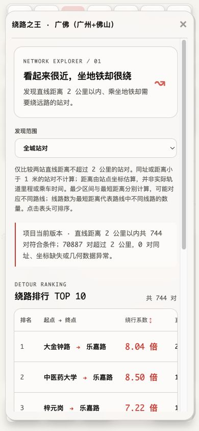
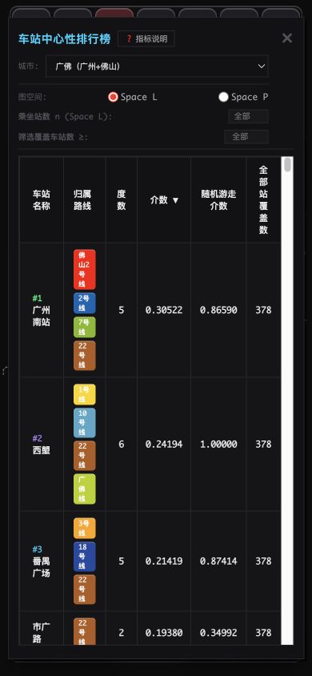
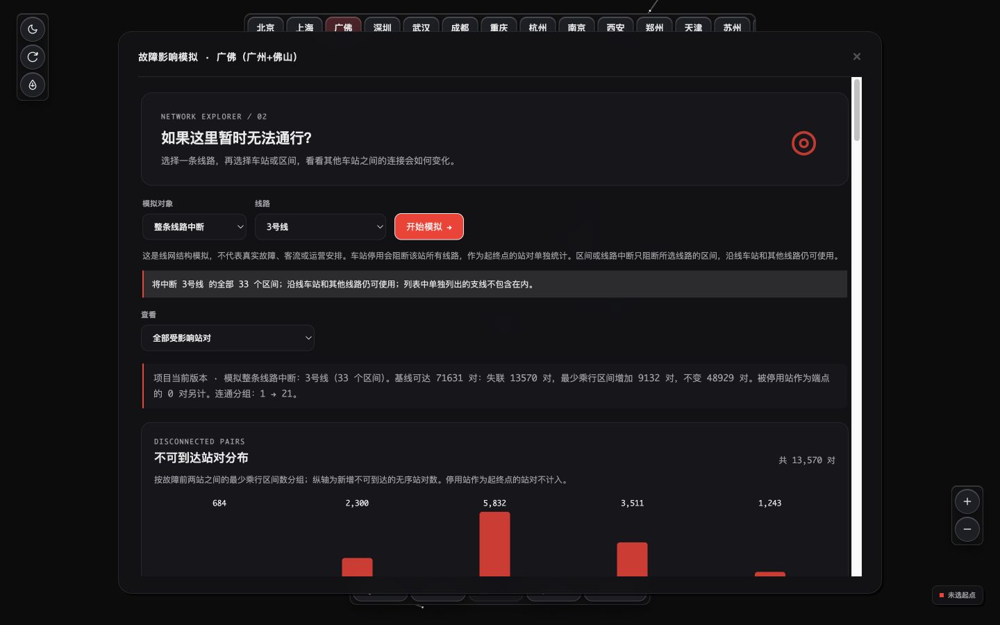
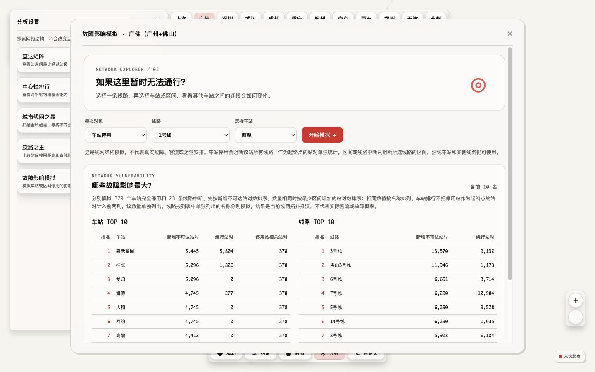
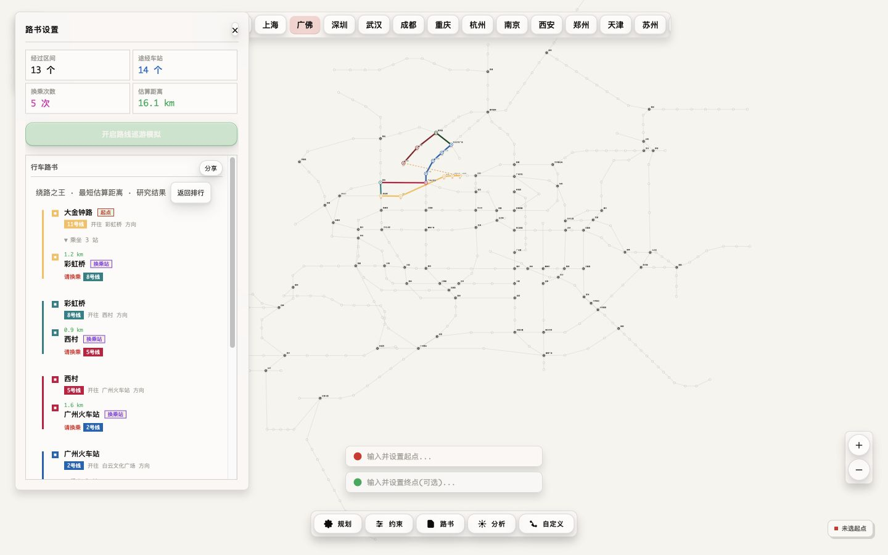
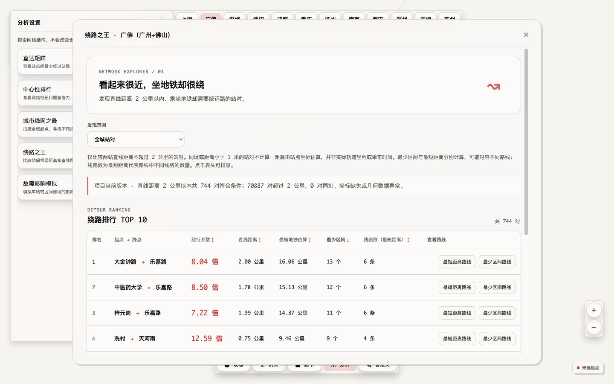

# 地铁路网研究工具｜交互与视觉设计审查

评审稿 v1 · 2026-11-02 · 待选择实施范围

当前页面已经具备明确的线网研究主题、地图主画布和可回到路书的研究路径。最值得投入的一轮迭代，是让结果更早出现、站名与指标更容易一起阅读，并让弹层和研究流程保持一致。

## 审查范围与证据

审查基线：本地 codex/network-research-v1 工作区，HEAD f07b44c 加本地未提交改动；预览 http://127.0.0.1:8765/。日期为2026-11-02。以广佛为操作样本，检查规划、分析入口、直达矩阵、中心性、绕路排行、故障排行/整线模拟、地图与路书往返；桌面1440×900、平板768×1024、手机390×844。深浅两种主题重点检查绕路页面。

本次是设计与交互审查，未修改业务页面、算法或城市数据，未同步GitHub。已使用浏览器实测和代码定位，截图属于本地当前数据版本的运行结果；未再次外部核验线路运营事实。未覆盖全部17城的逐城视觉回归，也未在真实iOS/Android设备上验证软键盘、触控和辅助技术。Taste原生lint/inspect命令未运行：当前终端找不到node；采用工具浏览器的多尺寸截图、DOM测量和键盘操作核对。文中没有把手工核对冒充原生脚本通过。

## 优先级定义

| 优先级 | 判定原则 | 数量 |
| :-- | :-- | --: |
| 高 | 直接影响主要结果的阅读、理解或核心操作 | 4 |
| 中 | 明显改善流程、解释和视觉一致性 | 7 |
| 低 | 发现性、用词和格式等细节改善 | 3 |

工作量“小/中”为相对判断，尚未作为工期承诺。优先级表达建议实施顺序。

## 优化清单总览

| 编号 | 优先级 | 优化项 | 相对工作量 |
| :-- | :-- | :-- | :-- |
| H1 | 高 | 手机与平板的分析表格需要专门布局 | 中 |
| H2 | 高 | 让排行和模拟结论成为首屏主体 | 中 |
| H3 | 高 | 补全分析弹窗的关闭、焦点和命名 | 小 |
| H4 | 高 | 提升小字、点击目标和放大阅读的可用性 | 中 |
| M1 | 中 | 让故障 Top 10 可以直接复现 | 小 |
| M2 | 中 | 统一车站选择器，复用线路分组与检索 | 中 |
| M3 | 中 | 查看研究路线后，让地图和状态对准当前对象 | 中 |
| M4 | 中 | 把排序依据和不同路线的指标归属说清楚 | 小 |
| M5 | 中 | 让不可达分布图具有明确刻度和比较语义 | 小 |
| M6 | 中 | 完善后台计算、取消和失败恢复的反馈 | 小 |
| M7 | 中 | 收敛新增模块的视觉层级，延续原页面风格 | 中 |
| L1 | 低 | 提高城市列表的横向可发现性 | 小 |
| L2 | 低 | 统一分析入口、标题和状态文案 | 小 |
| L3 | 低 | 统一数字格式与阈值边界的显示精度 | 小 |

## 建议保留的设计基础

- 保留地图主画布、底部五个入口、玻璃浮动控件、现有深浅主题、官方线路色和路书复用路径。
- 沿用已确认的2000米上限、Top 10入口、所有指标可排序、线路分组和三种故障对象；每项视觉优化都应服务这些现有能力。
- 保留“站点坐标估算距离”“结构模拟”“停用站端点另计”等关键口径，采用就近短提示和可展开说明承载。
- 先改善信息顺序、移动阅读和操作反馈；复用现有组件及变量，控制改动范围。Taste的营销页照片、强动效和视觉随机方案不适用于此研究工具；本次采用它的应用界面审查规则。

## 高优先级

### H1 手机与平板的分析表格需要专门布局

**发现与证据**：已实测：390×844 下绕路表格容器宽 320px、内容宽 898px；768×1024 下为 679px / 898px。站名列 position 为 static，横向滚动后会失去站对身份。中心性表格在手机上将线路徽标和“全部站覆盖数”挤成多行竖排。

**用户影响**：读者无法在同一视野比较“哪两个站、要绕多少区间、涉及多少条线”，旧中心性表格也明显降低了扫描效率。

**建议调整**：桌面保留全部指标和可排序表头。手机先展示站对、当前排序指标和“查看路线”，展开行显示其余指标；所有指标仍可通过紧凑排序控件访问。若保留完整横向表格，则固定站对列、提供明确的横向滚动提示。中心性手机行改为“站名＋主指标”，线路徽标横向换行，次级指标放详情。

**验收标准**：390、768、1440 三档均能识别站名和当前排序指标；不出现逐字竖排；横向滚动时站对仍可识别；现有每个数值指标的升降序能力保留。

**实现定位**：styles.css:2852；network-research-ui.js:204；index.html:490。相对工作量：中。

**截图证据**：[mobile-detour.jpg](screenshots/mobile-detour.jpg)、[tablet-detour.jpg](screenshots/tablet-detour.jpg)、[mobile-centrality.jpg](screenshots/mobile-centrality.jpg)。

### H2 让排行和模拟结论成为首屏主体

**发现与证据**：已实测：桌面绕路表格起始位置约 y=539px，手机约 y=604px；手机故障结果摘要约 y=614px、分布图约 y=765px。前方依次为宣传式标题块、筛选、长口径说明、状态段落。

**用户影响**：进入分析后先读说明，再找结果；故障结果虽已计算完成，读者仍需从长句中寻找新增不可达、绕行和不变数量。

**建议调整**：压缩顶部为“功能名＋城市＋一句范围说明”，筛选后立即显示结果。绕路显示“直线≤2公里 · 744对 · 当前按最少区间降序”；故障以一个紧凑摘要组显示新增不可达、仍可达但绕行、未变化，分母在同组标明。完整口径放入可展开的“计算口径”，保留估算距离和停用站端点另计的关键说明。

**验收标准**：手机首屏可见结论及至少一条有效结果；故障完成后能直接读出三类计数和比较范围；三类之和与基线可达站对数一致，端点另计不混入比例。

**实现定位**：network-research-ui.js:40；network-research-ui.js:43；network-research-ui.js:197；styles.css:2787。相对工作量：中。

**截图证据**：[desktop-detour.jpg](screenshots/desktop-detour.jpg)、[mobile-detour.jpg](screenshots/mobile-detour.jpg)、[desktop-failure-result.jpg](screenshots/desktop-failure-result.jpg)、[mobile-failure-result.jpg](screenshots/mobile-failure-result.jpg)。

### H3 补全分析弹窗的关闭、焦点和命名

**发现与证据**：已实测：绕路弹窗按 Escape 后仍为 display:flex；故障弹窗关闭按钮上按 Shift+Tab，焦点移到背景的 btn-open-failure。弹窗虽有 role=dialog、aria-modal=true，却没有 aria-labelledby 或 aria-label。

**用户影响**：键盘使用者可能在看不见的背景上操作；Esc 与其他分析浮层的行为不一致，辅助技术也得不到明确弹窗名称。

**建议调整**：把研究弹窗接入现有统一退出逻辑；打开时记录触发入口，Tab 在弹窗内循环，关闭后归还焦点。用 research-title 作为可访问名称。优先复用现有弹层机制；必要时采用原生 dialog，保持当前外观。

**验收标准**：Esc 关闭最上层弹窗；Tab/Shift+Tab 均不进入背景；关闭后焦点回到原入口；辅助技术可读出“绕路之王”或“故障影响模拟”。

**实现定位**：network-research-ui.js:5；network-research-ui.js:16；network-research-ui.js:104；index.html:1675。相对工作量：小。

**截图证据**：[desktop-detour.jpg](screenshots/desktop-detour.jpg)。

### H4 提升小字、点击目标和放大阅读的可用性

**发现与证据**：已实测：排序按钮文字 11px、实际按钮高度约 15px，筛选标签 11px，装饰英文标签 10px，模拟主按钮约 38.5px。代码中 viewport 设置 maximum-scale=1.0、user-scalable=no。

**用户影响**：高密度指标不易阅读，触屏排序容易点错；浏览器放大阅读能力还受到页面配置限制。

**建议调整**：正文和关键数据以 14px 为目标，次级说明以 12px 为目标；中文正文使用清晰的系统字体，数字保留等宽排列。把表头整格做成点击区域，手机主要交互目标以 44px 为目标。允许浏览器页面缩放，保留地图区域自己的拖动与缩放逻辑。

**验收标准**：触屏主要操作区达到目标尺寸；200% 阅读缩放时字段和关闭按钮可达；正文不被截断；地图拖动、输入、内部滚动和浏览器缩放经过手机验证。

**实现定位**：styles.css:108；styles.css:2788；styles.css:2793；styles.css:2863；index.html:5。相对工作量：中。

**截图证据**：[mobile-centrality.jpg](screenshots/mobile-centrality.jpg)、[mobile-detour.jpg](screenshots/mobile-detour.jpg)。

## 中优先级

### M1 让故障 Top 10 可以直接复现

**发现与证据**：已核对页面及代码：车站、线路 Top 10 都是静态表格单元格，没有行级模拟动作；当前还需要回到上方重新选择对象、线路和车站。

**用户影响**：页面已经给出最值得研究的对象，却没有把“发现问题”连到“查看影响”。

**建议调整**：每行增加“模拟”文本按钮；点击后填充现有表单并执行同一套模拟。车站停用仍表示该逻辑车站所有线路停用；所属线路仅用于定位选择。运行后保留“返回影响排行”的入口。

**验收标准**：从任意 Top 10 行一次操作得到对应结果；对象名称、模拟范围和计数与手动选择完全一致；返回后保留原排行位置。

**实现定位**：network-research-ui.js:123。相对工作量：小。

**截图证据**：[desktop-failure-ranking.jpg](screenshots/desktop-failure-ranking.jpg)、[mobile-failure-ranking.jpg](screenshots/mobile-failure-ranking.jpg)。

### M2 统一车站选择器，复用线路分组与检索

**发现与证据**：已核对：绕路使用包含全城线路 optgroup 的原生长下拉，故障使用“线路＋站名”两个原生下拉；旧直达矩阵已有 station-select-menu 的线路展开式选择器。

**用户影响**：不同模块找站方式不一致，长下拉虽有线路分组，仍需翻找；熟悉旧页面的人需要重新适应。

**建议调整**：优先复用旧页面的线路展开模式、颜色标记和站序，补充一个站名检索入口；绕路仍只保留一个“发现范围”，默认全城。故障保持先选线路、后选站或区间端点的顺序，不增加额外筛选条件。

**验收标准**：完整站名可直接命中；同名/别名与换乘站能明确辨认；键盘可搜索、选择和退出；切换线路后无效端点被清空。

**实现定位**：network-research-ui.js:29；network-research-ui.js:42；index.html:465；index.html:3932。相对工作量：中。

**截图证据**：[mobile-detour.jpg](screenshots/mobile-detour.jpg)、[mobile-matrix.jpg](screenshots/mobile-matrix.jpg)。

### M3 查看研究路线后，让地图和状态对准当前对象

**发现与证据**：已实测：大金钟路—乐嘉路的最短估算距离路线能进入既有路书，并可返回排行；地图仍保留全城视角，局部路线占比较小。此时页面右下仍显示“未选起点”。

**用户影响**：路线查看已经连通，但读者需要手动定位；“未选起点”容易被理解为当前研究路线尚未生效。

**建议调整**：查看路线时按所选路径自动适配视野，并避让路书抽屉；保留“全城视图/恢复视角”。状态文案显示“正在查看研究路线”，与规划起终点状态区分。返回排行时高亮原行并保留排序、范围和滚动位置。

**验收标准**：路线及端点位于未被抽屉遮挡的区域；恢复全城视图只需一次操作；返回后能找到原行；查看研究路线不更改用户的规划条件。

**实现定位**：index.html:4515；index.html:3033；network-research-ui.js:217。相对工作量：中。

**截图证据**：[desktop-research-roadbook.jpg](screenshots/desktop-research-roadbook.jpg)。

### M4 把排序依据和不同路线的指标归属说清楚

**发现与证据**：已核对：默认按最少区间降序，最醒目的数值却是红色绕行系数；每个未激活表头都显示红色双向箭头。最少区间与最短估算距离独立计算，而线路数仅属于最短距离代表路线。

**用户影响**：读者可能以为排行按红色倍数排序，或把线路数、距离和区间数误认为同一条路线的所有属性。

**建议调整**：结果标题旁明确“按最少区间 ↓”，仅激活排序列展示强调箭头。将线路数标为“线路数·距离路线”，提供就近口径提示；查看路线的两个动作继续保留，并在详情中清楚标注当前使用哪种路线。站对是无序组合，表格可用“站A ↔ 站B”，实际路书仍保留方向。

**验收标准**：任何一次排序后，当前指标和方向清晰可见；全部指标仍可排序；线路数说明始终与其对应路线一致；不擅自更换已确认的排行算法。

**实现定位**：network-research-ui.js:11；network-research-ui.js:205；network-research-ui.js:221；styles.css:2858。相对工作量：小。

**截图证据**：[desktop-detour.jpg](screenshots/desktop-detour.jpg)。

### M5 让不可达分布图具有明确刻度和比较语义

**发现与证据**：已核对：当前柱高按本次最大分组数归一，柱顶有计数，底部有区间分桶；没有可见的纵轴刻度。组距分别为1–5、6–10、11–20、21–30、31+，并不等宽。

**用户影响**：单次图的数量可以读到，但多次模拟的柱高不能直接比较；读者也可能把分桶计数当成等组距直方图的密度。

**建议调整**：补0起点和少量整数刻度、纵轴单位“站对数”；标明“按故障前最少区间分组的计数”，继续使用分类柱状图，不暗示等组距密度。标题附近注明每次模拟独立缩放。总量为0时保留明确的零结果说明。

**验收标准**：柱顶计数与分组和一致；最大值有留白；0值不画虚假高度；390px下刻度和标签不碰撞；零结果可与加载失败区分。

**实现定位**：network-research-ui.js:127；styles.css:2844。相对工作量：小。

**截图证据**：[desktop-failure-result.jpg](screenshots/desktop-failure-result.jpg)。

### M6 完善后台计算、取消和失败恢复的反馈

**发现与证据**：已核对：后台排行已有“完成x/总数”和取消动作，排行完成后有本次页面会话缓存；单次模拟错误提示要求重新打开重试。顶部普通结果、计算状态和错误状态共用相近的长段落样式。

**用户影响**：等待期间不易判断当前阶段；出现失败后必须退出重开；实时计算和已有结果的关系不够明显。

**建议调整**：区分准备、计算、完成、取消、失败五种状态；保留完成数量，增加阶段名称和进度条。失败时在当前位置提供重试，取消后提供继续探索的明确入口。可显示“本次已算结果”，有数据版本标识后再考虑持久缓存。

**验收标准**：取消后不再出现晚到结果覆盖；重试无需退出模块；没有结果、计算中和计算失败视觉上可区分；仅在有可信测量时展示预计剩余时间。

**实现定位**：network-research-ui.js:110；network-research-ui.js:185；network-research-ui.js:32。相对工作量：小。

**截图证据**：[mobile-failure-ranking.jpg](screenshots/mobile-failure-ranking.jpg)。

### M7 收敛新增模块的视觉层级，延续原页面风格

**发现与证据**：已核对截图及样式：新增模块叠加大圆角标题块、英文编号、说明区、状态区、结果区和大量行按钮；原模块的标题、边框、字体和按钮又有另一套密度。样式中存在先定义再覆盖的研究组件规则。

**用户影响**：新增分析像嵌进来的另一张页面，装饰和正文争夺注意力；重复边框与按钮加重信息密度。

**建议调整**：保留现有玻璃浮动工具、主题切换和红色强调。分析内容区提高底色实心度，只保留“弹层/分组/行”三个层次；取消无信息的英文编号和大符号，统一标题、说明、控件高度、圆角和间距。先复用现有样式变量，再清理重复覆盖，保持原有框架。

**验收标准**：浅色和深色主题均可读；新增与旧模块的标题和控件形成同一套规则；红色优先用于选中、关键结果和故障状态；关键操作和数据不靠悬停才出现。

**实现定位**：styles.css:2751；styles.css:2774；network-research-ui.js:40。相对工作量：中。

**截图证据**：[desktop-detour.jpg](screenshots/desktop-detour.jpg)、[desktop-detour-light.jpg](screenshots/desktop-detour-light.jpg)、[desktop-analysis.jpg](screenshots/desktop-analysis.jpg)。

## 低优先级

### L1 提高城市列表的横向可发现性

**发现与证据**：已实测：17城使用横向标签；手机首屏只显示前部城市，桌面1440宽截图也未完整展示全部城市。

**用户影响**：新用户可能没有意识到后面还有城市。

**建议调整**：保留横向标签，增加轻量的边缘延续提示或左右翻动入口；选中城市自动保持可见。若补“全部城市”菜单，应与现有中文城市名称一致。

**验收标准**：不阅读帮助即可发现后续城市；键盘可切换；选中城市不会留在可视区之外。

**实现定位**：index.html:48；styles.css:143。相对工作量：小。

**截图证据**：[mobile-planning.jpg](screenshots/mobile-planning.jpg)、[desktop-analysis.jpg](screenshots/desktop-analysis.jpg)。

### L2 统一分析入口、标题和状态文案

**发现与证据**：已核对：抽屉名为“分析设置”“路书设置”，但内部主要是研究入口和路线查看；故障入口副标题仍写车站或区间，未覆盖整条线路。存在“站数/区间”“失联/不可到达/不可达”等不同说法。

**用户影响**：同一个动作或指标需要重新解释，新增功能范围也不容易在入口发现。

**建议调整**：统一“分析”“行车路书”等内容标题；故障副标题改为“模拟车站、区间或整条线路中断”。计数统一使用“乘行区间”；站点数量单独叫“途经车站”，并注明是否含端点；故障状态统一“新增不可达站对”。

**验收标准**：入口文案覆盖三种模拟对象；同一指标在排行、摘要、图表、路书里使用一致术语；术语修改不改变原计数规则。

**实现定位**：index.html:350；index.html:354；network-research-ui.js:197。相对工作量：小。

**截图证据**：[desktop-analysis.jpg](screenshots/desktop-analysis.jpg)、[desktop-research-roadbook.jpg](screenshots/desktop-research-roadbook.jpg)。

### L3 统一数字格式与阈值边界的显示精度

**发现与证据**：已核对：表格与图表已有部分千分位，但状态摘要仍显示71631、13570等无分隔数字；直线距离保留两位公里，接近2公里的合格站对会显示2.00公里。

**用户影响**：大数不易快速比较；临界站对的显示值不足以解释为何被纳入。

**建议调整**：所有计数统一千分位；标题或表头承载单位，减少每格重复单位。直线距离优先显示米，或在详情给出未四舍五入的筛选距离；仍按原始距离≤2000米筛选。

**验收标准**：计数格式一致；显示精度不参与筛选；临界站对可查看足够精度；距离仍明确为站点坐标估算。

**实现定位**：network-research-ui.js:197；network-research-ui.js:204。相对工作量：小。

**截图证据**：[desktop-detour.jpg](screenshots/desktop-detour.jpg)、[desktop-failure-result.jpg](screenshots/desktop-failure-result.jpg)。

## 建议实施顺序

### 第一批：可读、可操作

H1、H2、H3、H4。先完成响应式表格、结论摘要、弹层键盘行为和触控阅读。验收后再推进其余项。

### 第二批：研究流程连贯

M1、M2、M3、M4、M6。把发现、选择、模拟、查看路线和返回连成完整路径，补足计算失败的恢复动作。

### 第三批：视觉和细节统一

M5、M7、L1、L2、L3。完善图表刻度、层级、文案和数字格式。M7的字体与控件基础规则可提前与H4共用。

## 验收清单

- 1440、768、390三档：表格身份列、排序、长站名、长线路名和Top 10操作完整；页面不出现整体横向溢出。
- 完整走通：全城排行→按任意数值排序→查看两种路线→返回原位置；故障Top 10→一键模拟→看结论→回到排行。
- 故障三种对象均覆盖；区间同起终点、环线双路径、零新增不可达、停用站端点另计均有清晰状态。
- 复核显示值：广佛3号线整线中断样本中，13,570新增不可达、9,132绕行、48,929未变化，合计71,631；这是结构站对计数。若展示占比，分母明确为对应基线站对，不解释为乘客占比。
- 键盘：Esc、Tab、Shift+Tab、焦点回归、选择器检索和所有排序均可用；弹层可访问名称明确。
- 真实手机：软键盘出现/消失、内部滚动、横向表格、地图手势、横竖屏、安全区、200%放大阅读；本次未执行这些真机验收。
- 等待/取消/错误/重试：状态可区分，旧任务不会覆盖新任务；长站名不会盖住主操作。

## 本轮视觉判断

以下是基于已查看截图的主观设计判断，不是可用性实验或算法准确性评分。应用界面不采用营销页的图片数量、强动效等评分限制。

ROUND 1

- 第一眼看到：线路地图；进入新分析模块后，大标题和说明先于排行或模拟结论。
- 设计主张：让每一个有趣的站对或脆弱节点，都能从排行进入地图和路书验证。
- 主要交互：选站/选线路、点击指标排序、查看代表路线、模拟停用并比较。
- 布局：主页面为地图＋浮动抽屉；分析为弹层＋筛选＋结果；路书为列表＋地图。
- 主观评分：设计6、易用5、产品辨识7、内容7，加权6.0/10。没有进行“优化后”评分。
- 三个最显著问题：手机表格阅读（H1）、结论位置与层级（H2）、弹层键盘行为（H3）。
- 应用界面七项核对：主问题可答但结论靠后；桌面大体对齐、手机列宽失衡；红色与装饰竞争；抽查计数闭合；零结果已有说明；图表缺刻度；手机需要专门排版。

## 截图摘录

### 手机绕路排行：说明先于结果，关键字段需要横向查看

### 手机中心性：线路徽标与表头被挤成竖排

### 故障模拟：主要计数埋在状态段落中

### 故障排行：表格已有数据，尚无直接模拟动作

### 研究路线：路书已连通，全城视角与状态仍可优化

### 浅色主题：层级较清晰，可继续收敛边框和顶部高度

## 评审记录

本轮产物为审查意见与实施验收依据。选择实施范围后，再在本地开发分支迭代；继续遵守用户测试确认后才同步GitHub的约定。

方法来源：[Taste skill](https://github.com/Leonxlnx/taste-skill)，采用已安装版本的应用界面规范与截图审查方法。
